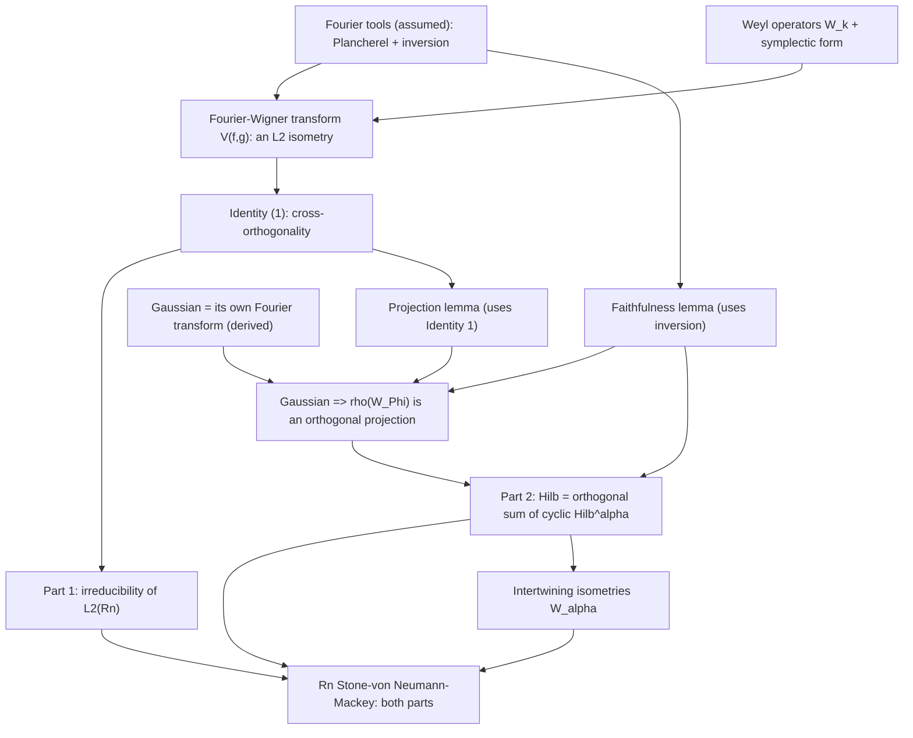
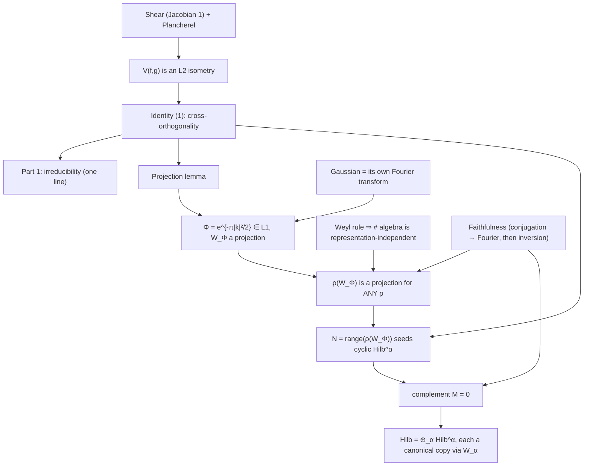

> [!quote] YOU

> [!note] SKILL loaded: teach

I want to learn the proof of the Stone-von Neumann theorem according to the paper by Prasad (in the folder)

> [!abstract] PI

Found the paper. Let me read through it first.

> [!abstract] PI

I've read the full paper. Before we dive in, let me map where your understanding sits so I can build the proof from solid ground. I'll run a few quick probes on the machinery the proof leans on (Hilbert spaces, representations, Peter-Weyl, Pontryagin duality, Fourier analysis), then check what exactly you want out of this.

Let me start with the operator-theory foundation the proof uses constantly.

> [!question] Quiz
> In the Rⁿ part of the proof, Prasad shows a certain operator ρ(W_Φ) is an "orthogonal projection." What two algebraic conditions must a bounded operator P on a Hilbert space satisfy to be an orthogonal projection?
>
> In the Rⁿ part, Prasad concludes ρ(W_Φ) is an "orthogonal projection." Which pair of algebraic conditions characterizes one?
>
> 1. P*P = I and P* = P
> 2. P² = I and P* = P
> 3. P² = P and P* = P
> 4. P² = P and P* = -P

> [!success] Quiz — correct ✓
> Your answer: 3. P² = P and P* = P
> Correct answer: 3
>
> A projection is idempotent (P² = P, i.e. projecting twice is the same as projecting once). It is *orthogonal* exactly when it's also self-adjoint (P* = P), which forces ker P = (im P)⊥. So the two conditions are P² = P and P* = P. The other options are real, easily-confused operators: P² = I with P* = P is a self-adjoint unitary (a "symmetry," e.g. reflection, not a projection — applying it twice gives the identity, not a collapse onto a subspace); P*P = I with P* = P describes a self-adjoint isometry; P* = -P is skew-adjoint (like multiplication by i).

> [!abstract] PI

Right. That's the operator-theory floor. Now let me probe the representation-theory vocabulary the theorem is stated in.

> [!question] Quiz
> Part (1) of the theorem says L²(L) has "no non-trivial proper closed subspace invariant under H." What is the name of a representation with exactly this property?
>
> Part (1) of the theorem says L²(L) has "no non-trivial proper closed subspace invariant under H." What is the name of a representation with this property?
>
> 1. Irreducible:
> 2. Cyclic:
> 3. Transitive:
> 4. Irreducible:

> [!success] Quiz — correct ✓
> Your answer: 1. Irreducible:
> Correct answer: 1
>
> A representation with no non-trivial proper closed invariant subspaces is called irreducible. Note the distinction from "cyclic": cyclic means there's ONE vector v whose orbit {h·v} has dense span — a much weaker condition about a single vector's orbit, not about the lattice of invariant subspaces. The proof of part (2) of the theorem actually constructs cyclic subspaces (closures of H·v_α) and shows each copy of the canonical representation is generated by one vector — irreducibility is about the space, cyclicity is about a vector.

> [!abstract] PI

Good — the vocabulary is in place. Now let me probe the engine of the compact-open-subgroup half of the proof: the Peter-Weyl decomposition.

> [!question] Quiz
> In the compact-open-subgroup proof, Prasad applies Peter-Weyl to the action of the compact abelian group G×G^⊥ on Hilb, getting Hilb = ⊕_{(η,a)} Hilb_{η,a}, each a joint eigenspace. What exactly does Peter-Weyl give in this setting?
>
> Prasad applies Peter-Weyl to the action of the compact abelian group G×G^⊥ on Hilb, getting Hilb = ⊕_{(η,a)} Hilb_{η,a} with each Hilb_{η,a} a joint eigenspace. What exactly does Peter-Weyl give in this (compact abelian) setting?
>
> 1. A direct sum of finite-dimensional irreducibles
> 2. A direct sum of 1-dimensional eigenspaces
> 3. A direct integral of 1-dimensional characters
> 4. Simultaneous diagonalization of all operators

> [!question] Quiz — I don't know
> Your answer: I don't know
> Correct answer: 2
>
> For a compact group, Peter-Weyl says a unitary representation decomposes as a direct sum of finite-dimensional irreducibles. But G×G^⊥ here is abelian, and irreducible unitary representations of an abelian group are 1-dimensional characters (an invariant subspace of a commuting family of operators has every vector as a joint eigenvector). So the sharp form he uses is: decomposition into 1-dimensional joint eigenspaces labeled by characters of G×G^⊥. The 'finite-dimensional irreducibles' option is the general compact Peter-Weyl — true, but not the sharp abelian form; 'direct integral' is the non-compact abelian picture (like L²(ℝ) as a direct integral of characters); simultaneous diagonalizability with finite-dimensional eigenspaces is false in general (multiplicities can be infinite).

> [!abstract] PI

I don't know — a genuine gap, and a good one to find now: Peter-Weyl is the engine of the first half of the proof, so we'll need to build it in. Let me keep mapping the rest of the territory. Next strand: Pontryagin duality, which the paper uses to set up the compact-open-subgroup case.

> [!question] Quiz
> §2.2 of the paper claims: if A is a discrete abelian group, its Pontryagin dual  is compact. Why?
>
> §2.2 of the paper claims: if A is a discrete abelian group, its Pontryagin dual  is compact. Why?
>
> 1. Â has the uniform-convergence topology
> 2. Â has the pointwise-convergence topology
> 3. Â has the pointwise-convergence topology
> 4. A is a compact group

> [!question] Quiz — I don't know
> Your answer: I don't know
> Correct answer: 3
>
> Note: I know the example the dual of Z is U(1), but I don't know this general fact
>
> The dual  carries the topology of pointwise convergence (equivalently, the compact-open topology — for a discrete A the two agree, and every homomorphism A→T is automatically continuous). Pointwise convergence means  sits inside the product T^A (each character is a point of the product). T is compact, so T^A is compact by Tychonoff, and  is closed in it (a pointwise limit of homomorphisms is a homomorphism), hence compact. The 'uniform convergence' topology is what you get when the domain is compact — that's the other direction of the compact/discrete swap. 'Open subgroup' is a trap: open subgroups of compact groups need not be compact; closed is the property that gives compactness.

> [!abstract] PI

Useful — you have the concrete anchor (ℤ → U(1)) but not the general mechanism, so I can build the duality facts up from that example. Let me probe the last major strand: the Fourier-analysis engine behind the Rⁿ half of the proof.

> [!question] Quiz
> In the Rⁿ proof, Prasad shows the Fourier-Wigner transform V(f,g) is an isometry L²(R^{2n}) → L²(R^{2n}). His argument: V(f,g) is "a Fourier transform in one variable of a function obtained from F by the volume-preserving change of variables…, and therefore extends to an isometry of L²(R^{2n}) onto L²(R^{2n})." Which theorem justifies the "extends to an isometry" step?
>
> Prasad: "V(f,g) is a Fourier transform in one variable of a function obtained from F by the volume-preserving change of variables…, and therefore extends to an isometry of L²(R^{2n}) onto L²(R^{2n})." Which theorem justifies the "extends to an isometry" step?
>
> 1. Riemann-Lebesgue lemma
> 2. Fourier inversion theorem
> 3. Plancherel theorem
> 4. Parseval's identity

> [!question] Quiz — I don't know
> Your answer: I don't know
> Correct answer: 3
>
> That step is Plancherel: the Fourier transform, initially defined on a dense subclass (say L¹∩L²), is an isometry there (preserves the L² norm), and therefore extends uniquely to a unitary isometry on all of L². The volume-preserving change of variables preserves the L² norm, and the one-variable Fourier transform is an L² isometry by Plancherel — compose the two and you get an isometry. Don't confuse it with Fourier inversion (f is recoverable from its transform — that's what the faithfulness lemma uses, where Ψ̂=0 forces Ψ=0). Both theorems appear in this paper, at different steps. Parseval for Fourier series is the analogous statement on the circle, not on R^n. Riemann-Lebesgue is an L¹ decay statement, not an isometry.

> [!abstract] PI

Let me pin down the floor of your Fourier knowledge, since the Rⁿ half of the proof is built on it.

> [!question] Quiz
> Just to calibrate: at the most basic level, what does the (continuous) Fourier transform do to a function f on R^n?
>
> Just to calibrate: at the most basic level, what does the (continuous) Fourier transform do to a function f on R^n?
>
> 1. Rewrites f as a sum of delta functions
> 2. Rewrites f as a superposition of exponentials e^{2πi ξ·x}
> 3. Re-expresses f so pointwise multiplication becomes convolution
> 4. Rewrites f as a superposition of polynomials

> [!success] Quiz — correct ✓
> Your answer: 2. Rewrites f as a superposition of exponentials e^{2πi ξ·x}
> Correct answer: 2
>
> The Fourier transform decomposes f into a superposition of the exponentials e^{2πi ξ·x} (the characters of R^n), with the coefficient at frequency ξ given by integrating f against e^{-2πi ξ·x}. This is the continuous analogue of writing a periodic function as a sum of harmonics (Fourier series). The 'delta functions at the zeros' and 'Taylor/polynomial' options are unrelated operations. The 'preserves pointwise multiplication as convolution' phrasing gestures at a real property (the transform turns products into convolutions) but misstates what the transform *is* — it's a re-expression in the exponential basis, and the multiplication↔convolution fact is a consequence, not the definition.

> [!abstract] PI

Your Fourier floor is solid (the exponential decomposition), with the gap at Plancherel/inversion level. Last strand to map: the algebraic core — the commutation relation that defines the Heisenberg group.

> [!question] Quiz
> The translation and modulation operators satisfy T_x M_χ = e^{2πiχ(x)} M_χ T_x (a non-trivial phase). Prasad defines H = {e^{2πit} T_x M_χ : t∈T, x∈L, χ∈L̂} — note the scalar torus t∈T is included. Why can't we just take the set {T_x M_χ} alone as the group?
>
> The translation and modulation operators satisfy T_x M_χ = e^{2πiχ(x)} M_χ T_x (a non-trivial phase). Prasad defines H = {e^{2πit} T_x M_χ : t∈T, x∈L, χ∈L̂} — note the scalar torus t∈T is included. Why can't we just take the set {T_x M_χ} alone as the group?
>
> 1. The map (x,χ) ↦ T_x M_χ is not continuous
> 2. T_x M_χ is not unitary on its own
> 3. The product (T_x M_χ)(T_{x'} M_{χ'}) is a scalar multiple of T_{x+x'} M_{χ+χ'}, generally with scalar ≠ 1
> 4. T_x and M_χ do not commute

> [!failure] Quiz — incorrect ✗
> Your answer: 4. T_x and M_χ do not commute
> Correct answer: 3
>
> Multiplying two such operators gives (T_x M_χ)(T_{x'} M_{χ'}) = e^{-2πiχ(x')} T_{x+x'} M_{χ+χ'} — a scalar multiple of another T·M operator, where the scalar e^{-2πiχ(x')} is generally not 1. So the set {T_x M_χ} is NOT closed under multiplication: the product falls out by a phase. Adjoining the scalar torus {e^{2πit}} absorbs these phases and makes the set a group. This is why the Heisenberg group is a *central extension* of L×L̂ by the circle group T — the center T is exactly where the commutator phases live. The other options are traps: T_x M_χ is already unitary (product of unitaries), so no phase is needed for unitarity; the non-commutativity is real but 'symmetrizing' isn't the issue; and continuity of the map is unrelated to why the scalars are needed.

> [!abstract] PI

That's a real partial grasp — you've got the non-commutativity, but the "symmetrize" framing is pointing at the wrong mechanism. Let me pin down exactly what's missing, because this closure point is the heart of why the center exists.

> [!question] Quiz
> Concretely: say (T_x M_χ)(T_{x'} M_{χ'}) = c·T_{x+x'} M_{χ+χ'} for some scalar c, where c is generally not 1. If we try to treat the set {T_x M_χ : x, χ} as a group under composition, which group requirement fails?
>
> Concretely: say (T_x M_χ)(T_{x'} M_{χ'}) = c·T_{x+x'} M_{χ+χ'} for some scalar c, where c is generally not 1. If we try to treat the set {T_x M_χ : x, χ} as a group under composition, which group requirement fails?
>
> 1. Closure under the operation
> 2. Existence of inverses
> 3. Existence of an identity
> 4. Associativity

> [!success] Quiz — correct ✓
> Your answer: 1. Closure under the operation
> Correct answer: 1
>
> Closure fails. The product of two elements of the set is c·(an element of the set). When c ≠ 1, that product is NOT itself in the set — it's a scalar multiple of an element, not an element. So the set isn't closed under the operation, which is the first group axiom to break. The identity (take x=0, χ=0, giving the identity operator) and inverses (T_x M_χ has inverse e^{2πiχ(x)} M_{-χ} T_{-x}, up to the phase) and associativity (composition of operators is always associative) all still work — it's specifically closure that fails. This is precisely why adjoining the scalar torus fixes it: the scalars absorb the stray phases c and restore closure.

> [!abstract] PI

I now have a clear map of where you are. Let me lay it out before we plan:

**You have (solid floor):**
- Hilbert-space operator basics (projections, isometries, invariant subspaces)
- Representation vocabulary (irreducible vs cyclic)
- Fourier transform at the basic level (exponential decomposition)
- The closure/central-extension point (you nailed it once made concrete)

**Gaps to build before the proof:**
- **Peter-Weyl** (compact-abelian form → joint eigenspaces) — the engine of the compact-open half
- **Pontryagin duality** in general — you have the ℤ→U(1) anchor, not the machinery
- **Plancherel + Fourier inversion** (the L² isometry and the recoverability fact) — the engine of the Rⁿ half
- The Gaussian-as-its-own-Fourier-transform fact

Now, one thing I need from you before I plan the teaching: the paper proves the theorem in **three parts**, and each leans on a different engine.

> [!question] Question
> What do you want out of this session — which part of the proof, and at what depth?
>
> Prasad's paper proves Stone-von Neumann-Mackey in three parts: (1) the compact-open-subgroup case via Peter-Weyl (the paper's "new" proof; handles groups like ℚₚ, the adeles); (2) the ℝⁿ case via the Fourier-Wigner transform + Plancherel + inversion + the Gaussian (von Neumann's original proof); (3) the general case, which reduces everything to L = E×ℝⁿ using the Pontryagin-van Kampen structure theorem and combines (1) and (2). Given your gaps (Peter-Weyl, Pontryagin duality, Plancherel), the full proof is a sizable build. Which do you want to target?
>
> 1. The whole proof, all three parts, in order
> 2. Focus on the ℝⁿ (Fourier / von Neumann) part
> 3. Focus on the compact-open (Peter-Weyl) part
> 4. Big-picture strategy first, details later

> [!example] Answer
> 2. Focus on the ℝⁿ (Fourier / von Neumann) part

> [!abstract] PI

You've got a clear target now: the **ℝⁿ (Fourier / von Neumann) half** of the proof — both parts (irreducibility and uniqueness/multiplicity). Let me lay out how I'd teach it.

## The approach

The paper treats three Fourier facts as given "classical tools": **Plancherel** (the Fourier transform is a unitary isometry on L²), **Fourier inversion** (a function is recoverable from its transform — in particular transform-zero ⇒ function-zero), and the concrete fact that the **normalized Gaussian is its own Fourier transform**. I'll take the first two as assumed tools (stating them precisely and confirming you accept them — proving them is a separate course), and I'll *derive* the Gaussian fact by hand, since it's short and it's where the proof gets its special vector.

Everything else is then built in a motivated chain:

1. **Weyl operators** `W_k = e^{πixy} T_x M_y` — a motivated move to absorb the messy commutation phase into a clean multiplication rule `W_k W_l = e^{πiω(k,l)} W_{k+l}` (ω = symplectic form).
2. **Fourier–Wigner transform** `V(f,g)(k) = ⟨W_k f, g⟩` and why it's an L² isometry (Plancherel + a volume-preserving change of variables).
3. **Identity (1)** — the cross-orthogonality `⟨V(f,g), V(φ,ψ)⟩ = ⟨f,φ⟩·overline{⟨g,ψ⟩}`. This one identity is the engine of the whole proof.
4. **Part 1 (irreducibility)** — a short, elegant argument that falls straight out of Identity (1). I'll set it up and let you try it.
5. **Part 2 (uniqueness)** — the averaging operator `ρ(W_Φ)`, twisted convolution, two lemmas (faithfulness via inversion, projection via Identity (1)), the Gaussian giving an orthogonal projection, and the decomposition `Hilb = ⊕_α Hilb^α` with the intertwining isometries.

**Style:** Socratic where you can reason your way there (the Gaussian fact, Part 1, the "why average with a density?" moves); expository where it's standard machinery or beyond cold-reasoning reach (stating Plancherel/inversion, the twisted-convolution bookkeeping). A quick quiz-check after each node to confirm it landed before I build on it.

## The dependency map



**Stress-tested roots:** the only nodes I'm treating as foundational are the three Fourier tools. Plancherel and inversion are theorems the paper explicitly assumes, not things I'll prove here — flag it now if you'd rather I justify them. The Gaussian fact is *derived*, not assumed, so it's not a load-bearing root.

Does this plan work, or do you want to adjust the scope/depth before we start?

> [!quote] YOU

This seems good

> [!abstract] PI

Approved — let's build it. I'll go node by node, and after each one I'll drop a quick quiz to confirm it landed before we build on it.

## Node 1 — The two Fourier tools (assumed)

**Why these, why now.** The entire ℝⁿ proof runs on exactly two Fourier facts. I'm stating them precisely now so that when they appear later you'll recognize them instantly:
- one says *"taking a Fourier transform doesn't change L² size"* — that's what will make the Fourier–Wigner transform an isometry;
- the other says *"a function is determined by its transform"* — that's what will kill the leftover complement subspace in Part 2.

**The statements** (the paper's 2π-convention: `f̂(ξ) = ∫ f(x) e^{-2πi x·ξ} dx`):

- **Plancherel.** The Fourier transform preserves the L² *inner product*: for f, g ∈ L²(ℝⁿ), `⟨f̂, ĝ⟩ = ⟨f, g⟩`. In particular it's an isometry (‖f̂‖₂ = ‖f‖₂) and in fact **unitary** — it extends from the dense class L¹∩L² to a bijection of L² onto itself.

- **Inversion.** A function is recoverable from its transform: `f(x) = ∫ f̂(ξ) e^{2πi x·ξ} dξ` (where the integral makes sense). The consequence we'll use: if `f̂ = 0` a.e. then `f = 0` a.e. — the transform is **injective**.

**How to hold these.** Think of Plancherel as *"the Fourier transform is a rotation of L²"* — it reshuffles the information from the x-basis to the ξ-basis without changing any length or angle. Inversion says the reshuffle is *reversible* — nothing is lost, so the only function with a zero transform is the zero function.

Let me confirm you can now tell the two apart and know which job each does in this proof.

> [!question] Quiz
> Two Fourier tools, two jobs in this proof: (a) showing the Fourier–Wigner transform is an L² isometry; (b) the faithfulness lemma's step "Ψ̂ = 0 ⇒ Ψ = 0." Which tool does which job?
>
> Two tools, two jobs in this proof: (a) showing the Fourier–Wigner transform is an L² isometry; (b) the faithfulness lemma's step "Ψ̂ = 0 ⇒ Ψ = 0." Which tool does which job?
>
> 1. (a) Plancherel, (b) Plancherel
> 2. (a) Inversion, (b) Plancherel
> 3. (a) Inversion, (b) Inversion
> 4. (a) Plancherel, (b) Inversion

> [!success] Quiz — correct ✓
> Your answer: 4. (a) Plancherel, (b) Inversion
> Correct answer: 4
>
> (a) is Plancherel: to prove V is an isometry you need "Fourier transform preserves the L² inner product," which is exactly Plancherel (V is a one-variable Fourier transform composed with a volume-preserving change of variables, both of which preserve the inner product). (b) is inversion: "transform zero ⇒ function zero" is the injectivity consequence of the inversion theorem. The trap answers swap them or double one up — the key is that isometry-norm-preservation and recoverability/injectivity are two different theorems doing two different jobs.

> [!abstract] PI

Locked. Both tools are in place and you can tell them apart.

## Node 2 — The Gaussian is its own Fourier transform (derived)

**Why this, why now.** In Part 2 we'll need one *special* vector φ with two properties: (1) its "coherence function" `Φ(k) = ⟨W_k φ, φ⟩` must lie in L¹, so the averaging operator `ρ(W_Φ) = ∫ Φ(k) ρ(W_k) dk` is even defined; (2) `W_Φ` should turn out to be the projection onto the line spanned by φ. The **Gaussian** does both — and the *reason* is exactly that it's a fixed point of the Fourier transform. So let's earn that fact rather than take it on faith.

**The intuition.** The Fourier transform reads off a function's frequency content. A Gaussian bell curve has frequency content that is *also* a Gaussian bell curve — it's the one shape that looks the same in position space and frequency space. Let's see why, by completing the square.

**The computation** (one dimension, `f(x) = e^{-πx²}`):

```
f̂(ξ) = ∫ e^{-πx²} e^{-2πi x·ξ} dx  =  ∫ e^{-πx² - 2πi x·ξ} dx
```

Complete the square in the exponent:

```
-πx² - 2πi x·ξ  =  -π( x² + 2iξx )  =  -π( (x + iξ)² + ξ² )  =  -π(x + iξ)² - πξ²
```

So

```
f̂(ξ) = e^{-πξ²} · ∫ e^{-π(x + iξ)²} dx
```

The remaining integral is `∫ e^{-πu²} du = 1` — it does **not** depend on ξ, because `e^{-πz²}` is entire and decays fast, so we may slide the contour of integration down from the real axis to the line `Im(z) = -ξ` (the vertical sides of the contour vanish by Gaussian decay). Hence

```
f̂(ξ) = e^{-πξ²} = f(ξ).   ✓  The Gaussian is its own Fourier transform.
```

**Why π specifically.** With the `e^{-2πi x·ξ}` kernel, the cross-term `2πi x·ξ` and the `-πx²` combine *exactly* when you complete the square — the π in the Gaussian is tuned to the 2π in the kernel. Change either and the fixed-point property breaks.

**The normalization.** `∫ e^{-πx²}dx = 1`, so `‖e^{-πx²}‖₂² = ∫ e^{-2πx²}dx = 1/√2`. The unit vector is `2^{1/4}e^{-πx²}` in one dimension, i.e. the paper's `φ(u) = 2^{n/4} e^{-π|u|²}` in n dimensions.

Let me confirm the one non-obvious step — the contour slide — actually makes sense to you.

> [!question] Quiz
> After completing the square we need ∫ e^{-π(x+iξ)²} dx to equal ∫ e^{-πu²} du = 1, i.e. to be independent of ξ. Why is that contour slide legitimate?
>
> After completing the square we need ∫ e^{-π(x+iξ)²} dx to equal ∫ e^{-πu²} du = 1, i.e. to be independent of ξ. Why is that slide legitimate?
>
> 1. e^{-π(x+iξ)²} = e^{-πx²} pointwise
> 2. e^{-πz²} is entire and decays fast
> 3. The integration range is compact
> 4. The Gaussian is even under x ↦ -x

> [!success] Quiz — correct ✓
> Your answer: 2. e^{-πz²} is entire and decays fast
> Correct answer: 2
>
> The integrand e^{-πz²} is an entire function (no singularities anywhere in the complex plane) and decays super-fast away from the origin. So integrate it over a tall rectangle whose top edge is the real axis and whose bottom edge is the line Im(z) = -ξ; by Cauchy's theorem the two horizontal edges give equal integrals, and the two vertical edges vanish by Gaussian decay. Hence the integral along Im(z) = -ξ equals the integral along the real axis = 1. It is NOT true pointwise that e^{-π(x+iξ)²} = e^{-πx²} (there's a stray factor), the domain is all of R (not compact), and even-symmetry under x↦-x only shows the integral is even, not that it's independent of ξ.

> [!abstract] PI

Contour slide confirmed — the Gaussian fixed-point is earned, not assumed.

## Node 3 — The Weyl operators: turning a messy relation into a clean one

**Why this, why now.** The raw commutation relation is *order-dependent and ugly*: `T_x M_y = e^{-2πi y·x} M_y T_x`. Multiply two "T·M" operators and a scalar drops out that depends on the ordering. For the proof we want a family of unitaries `{W_k : k ∈ ℝ^{2n}}` with a **clean** multiplication rule — the product of two is a single phase times the "sum":

```
W_k W_l = e^{πi ω(k,l)} W_{k+l},
```

where ω is a fixed *antisymmetric* bilinear form. That clean rule is what makes the twisted-convolution and inner-product bookkeeping in Part 2 tractable. The Weyl operator is the device that produces it.

**The definition.** For `k = (x,y) ∈ ℝ^{2n}`, set

```
W_k = e^{πi x·y} T_x M_y.
```

The phase `e^{πi x·y}` is a **"square root" of the commutation phase** — note it's `π`, *half* of `2π`. That ½ is the whole trick. Here's the multiplication:

```
W_k W_l = e^{πi(x·y)} e^{πi(u·v)} T_x (M_y T_u) M_v
```

Move `M_y` past `T_u` using `M_y T_u = e^{+2πi y·u} T_u M_y`:

```
        = e^{πi(x·y + u·v)} e^{2πi y·u} T_{x+u} M_{y+v}.
```

Now `W_{k+l} = e^{πi(x+u)·(y+v)} T_{x+u} M_{y+v} = e^{πi(x·y + x·v + u·y + u·v)} T_{x+u} M_{y+v}`. Dividing, the three phase contributions — `e^{πi x·y}`, `e^{πi u·v}`, and `e^{2πi y·u}` — conspire to leave exactly

```
W_k W_l = e^{πi (y·u - x·v)} W_{k+l}  =  e^{πi ω(k,l)} W_{k+l},     where  ω(k,l) = y·u - x·v.
```

And `W_k^* = W_{-k}` (the family is self-adjoint under `k ↦ -k`).

**Why π and not 2π.** The `½` (i.e. `π` instead of `2π`) *splits the commutation phase symmetrically* between the two factors. With that split, the stray `e^{2πi y·u}` from moving `M_y` past `T_u` is exactly absorbed, and what remains is the clean **antisymmetric** form `ω(k,l) = y·u - x·v` (note `ω(k,l) = -ω(l,k)`, `ω(k,k)=0`). Use `e^{2πi x·y}` instead and the extra phase would not cancel — you'd get a messy, non-antisymmetric remainder.

**How to hold this.** The Weyl operators are the Heisenberg group written so that its "group law" is `k·l = k+l` up to a central phase `e^{πiω(k,l)}`. The phase is the *commutator*, now living in the center — exactly the closure fix from Node 0, packaged cleanly. Antisymmetry of ω is what lets swapping `k,l` just invert the phase.

Let me confirm the key design choice — the ½ in the phase — is clear.

> [!question] Quiz
> The Weyl operator is W_k = e^{πi x·y} T_x M_y. Why the factor e^{πi x·y} — in particular, why π (half of 2π) rather than 2π?
>
> The Weyl operator is W_k = e^{πi x·y} T_x M_y. Why the factor e^{πi x·y} — in particular, why π (half of 2π) rather than 2π?
>
> 1. It splits the commutation phase in half
> 2. It makes each W_k self-adjoint
> 3. It makes the map k ↦ W_k continuous
> 4. It normalizes W_k to unit operator norm

> [!success] Quiz — correct ✓
> Your answer: 1. It splits the commutation phase in half
> Correct answer: 1
>
> The π (the ½) splits the commutation phase symmetrically between the two factors. When you multiply W_k W_l, three phases appear: e^{πi x·y} (from W_k), e^{πi u·v} (from W_l), and e^{2πi y·u} (from moving M_y past T_u). With the ½-split these conspire to leave exactly the clean antisymmetric symplectic form e^{πi(y·u - x·v)} = e^{πiω(k,l)}. The traps: a unimodular phase doesn't change the norm (T_x M_y is already unitary), so it's not for normalization; W_k is unitary, not self-adjoint, in general; and k↦W_k is continuous regardless of the ½. The ½ is purely to make the multiplication rule clean and antisymmetric.

> [!abstract] PI

The ½-split is clear — the Weyl operators give us a clean, antisymmetric multiplication rule.

## Node 4 — The Fourier–Wigner transform, and why it's an L² isometry

**Why this, why now.** We have a clean family of unitaries `W_k`. Now we want to *measure a pair of vectors* `(f,g)` by watching how the `W_k` act on them. The result is a function on the whole phase space `ℝ^{2n}`:

```
V(f,g)(k) = ⟨W_k f, g⟩,      k = (x,y) ∈ ℝ^{2n}.
```

This is the **Fourier–Wigner transform**. The crucial claim: `V` is an **isometry** from `L²(ℝⁿ)⊗L²(ℝⁿ) ≅ L²(ℝ^{2n})` onto `L²(ℝ^{2n})`. That isomorphism is what will let us turn "orthogonality in phase space" into "orthogonality of the inputs" — the engine of the whole proof.

**First, it's well-behaved.** By Cauchy–Schwarz, `|V(f,g)(k)| = |⟨W_k f, g⟩| ≤ ‖W_k f‖‖g‖ = ‖f‖‖g‖` (unitarity of `W_k`), so `V(f,g)` is bounded. And `k ↦ W_k` is strongly continuous, so `V(f,g)` is continuous in `k`.

**The explicit formula.** Unwinding `W_k = e^{πix·y}T_x M_y`:

```
W_k f(u) = e^{-πi x·y} e^{2πi y·u} f(u - x),
```

so

```
V(f,g)(x,y) = ∫ e^{2πi y·(u - x/2)} f(u - x) ḡ(u) du
            = ∫ e^{2πi y·u} f(u - x/2) ḡ(u + x/2) du        … (shift u ↦ u - x/2)
```

**Why it's an isometry — the key move.** Set `F(a,b) = f(a)ḡ(b)`, so `F ∈ L²(ℝ^{2n})` with `‖F‖₂ = ‖f‖₂‖g‖₂`. Read the second formula as:

```
V(f,g)(x,y) = ∫ e^{2πi y·u} · F(u - x/2, u + x/2) du.
```

Two operations take `F` to `V(f,g)`:
1. **A change of variables** `(u,x) ↦ (u - x/2, u + x/2)`. Its Jacobian is
   ```
   det [[∂a/∂u, ∂a/∂x], [∂b/∂u, ∂b/∂x]] = det [[1, -½], [1, ½]] = ½ + ½ = 1.
   ```
   **Jacobian 1 ⇒ volume-preserving ⇒ it preserves the L² norm.**
2. **A one-variable Fourier transform** in the `u`-variable (the `e^{2πi y·u}` kernel, output in `y`). By **Plancherel**, this is an L² isometry.

Compose the two norm-preserving operations and `V` preserves the L² norm: `‖V(f,g)‖₂ = ‖F‖₂ = ‖f‖₂‖g‖₂`. Since it's an isometry on the dense algebraic tensor product, it **extends to a unitary** `L²(ℝ^{2n}) → L²(ℝ^{2n})`.

**How to hold this.** `V(f,g)` is just `F = f⊗ḡ` viewed through two norm-preserving lenses — a shear (the Jacobian-1 change of variables) and a Fourier transform in one axis. Neither lens changes any L² length, so `V` doesn't either. That's the entire isometry proof: *shear + Plancherel*.

Let me confirm you've separated the isometry from the mere boundedness/continuity.

> [!question] Quiz
> The claim that V is an L² ISOMETRY (not merely bounded and continuous) rests on which two facts?
>
> The claim that V is an L² ISOMETRY (not merely bounded and continuous) rests on which two facts?
>
> 1. Cauchy-Schwarz + strong continuity of k ↦ W_k
> 2. Antisymmetry of ω + unitarity of the W_k
> 3. The Gaussian fixed-point + contour slide
> 4. A volume-preserving change of variables + Plancherel

> [!success] Quiz — correct ✓
> Your answer: 4. A volume-preserving change of variables + Plancherel
> Correct answer: 4
>
> The isometry rests on: (1) the change of variables (u,x)↦(u-x/2, u+x/2) has Jacobian 1, so it's volume-preserving and preserves the L² norm; and (2) the one-variable Fourier transform is an L² isometry by Plancherel. V is exactly these two norm-preserving operations composed. The traps are real but do different jobs: Cauchy-Schwarz + strong continuity give BOUNDEDNESS and CONTINUITY of V(f,g), not the isometry; the antisymmetry of ω + unitarity of W_k give the clean MULTIPLICATION rule, not the isometry; the Gaussian fixed-point + contour slide are used later for the special vector, not here.

> [!abstract] PI

Shear + Plancherel — the isometry is locked. Now the payoff of that isometry.

## Node 5 — Identity (1): the cross-orthogonality engine

**Why this, why now.** An isometry preserves norms, but by polarization it preserves *inner products* too. That's the real engine, and it's a single line:

**The derivation.** `V` is a unitary sending `f⊗ḡ` to `V(f,g)`, so it preserves the inner product:

```
⟨V(f,g), V(φ,ψ)⟩  =  ⟨f⊗ḡ, φ⊗ψ̄⟩  =  ⟨f,φ⟩ · ⟨ḡ,ψ̄⟩  =  ⟨f,φ⟩ · overline{⟨g,ψ⟩}.
```

**Identity (1):**
```
⟨V(f,g), V(φ,ψ)⟩ = ⟨f,φ⟩ · overline{⟨g,ψ⟩}.
```

**Read it.** The inner product of two Fourier–Wigner transforms **factors** as *(inner product of the first-slot inputs) × (conjugate inner product of the second-slot inputs)*. Phase-space orthogonality decomposes cleanly into input orthogonality.

**The consequence Part 1 uses.** Set `φ = f`, `ψ = g`:

```
‖V(f,g)‖² = ⟨V(f,g), V(f,g)⟩ = ⟨f,f⟩·overline{⟨g,g⟩} = ‖f‖²‖g‖²,
```

so **`‖V(f,g)‖ = ‖f‖‖g‖`**. In particular, `V(f,g) ≡ 0` forces `f = 0` or `g = 0`. Note what this does *not* say: `V(f,g)` is not controlled by `⟨f,g⟩` — it can be nonzero even when `f ⊥ g`.

Let me confirm you've got the factorization and its sharp consequence.

> [!question] Quiz
> Identity (1): ⟨V(f,g), V(φ,ψ)⟩ = ⟨f,φ⟩·overline{⟨g,ψ⟩}. What is the sharp consequence the proof actually uses?
>
> Identity (1): ⟨V(f,g), V(φ,ψ)⟩ = ⟨f,φ⟩·overline{⟨g,ψ⟩}. What is the sharp consequence the proof actually uses?
>
> 1. V(f,g) vanishes
> 2. V(f,g) is independent of g
> 3. V(f,g) is real-valued
> 4. ‖V(f,g)‖ = ‖f‖·‖g‖

> [!success] Quiz — correct ✓
> Your answer: 4. ‖V(f,g)‖ = ‖f‖·‖g‖
> Correct answer: 4
>
> Set φ=f, ψ=g: ‖V(f,g)‖² = ⟨f,f⟩·overline{⟨g,g⟩} = ‖f‖²‖g‖², so ‖V(f,g)‖ = ‖f‖‖g‖, and V(f,g)≡0 forces f=0 or g=0. That's the engine of Part 1. The traps: V(f,g) very much depends on g (it's ⟨W_k f, g⟩); it's complex-valued in general; and it does NOT vanish just because f⊥g — setting φ=f,ψ=g never produces the quantity ⟨f,g⟩, so orthogonality of f and g says nothing about V(f,g). V(f,g) is a function on all of phase space, not a single inner product.

> [!abstract] PI

The engine is in place. Now Part 1 falls out almost for free — and it's short enough that I'd like *you* to land the final step.

## Node 6 — Part 1: irreducibility (Socratic)

**The claim.** The canonical representation of `H` on `L²(ℝⁿ)` is **irreducible**: no non-trivial proper closed `H`-invariant subspace.

**The setup** (here's the whole argument except the last move — complete it):

1. Let `M` be a non-zero closed `H`-invariant subspace. We'll show `M = L²(ℝⁿ)`.
2. Pick a non-zero `f ∈ M`.
3. `M` is `H`-invariant, so `W_k f ∈ M` for **every** `k`.
4. Take any `g ∈ M^⊥` (orthogonal to all of `M`).
5. Then `⟨W_k f, g⟩ = 0` for every `k` — because `W_k f ∈ M` and `g ⊥ M`.
6. Hence `V(f,g)(k) = ⟨W_k f, g⟩ = 0` for all `k`, i.e. **`V(f,g) ≡ 0`**.

Now the last move — use Identity (1).

> [!question] Quiz
> You've shown V(f,g) ≡ 0 for a non-zero f ∈ M and any g ∈ M⊥. Complete the argument: what does this force, and what does that imply about M?
>
> You've shown V(f,g) ≡ 0 for a non-zero f ∈ M and any g ∈ M⊥. Complete the argument: what does this force, and what does that imply about M?
>
> 1. g must be 0
> 2. g must be 0, hence M = {0}
> 3. V(f,g) is a non-zero constant
> 4. f must be 0

> [!success] Quiz — correct ✓
> Your answer: 1. g must be 0
> Correct answer: 1
>
> By Identity (1), ‖V(f,g)‖ = ‖f‖‖g‖. Since V(f,g)≡0, we get ‖f‖‖g‖ = 0. We chose f non-zero, so ‖f‖ > 0, forcing ‖g‖ = 0, i.e. g = 0. So the ONLY vector orthogonal to M is 0: M⊥ = {0}. A closed subspace whose orthogonal complement is trivial is the whole space, so M = L²(ℝⁿ). That's irreducibility. The traps: 'M = {0}' inverts the logic (trivial complement means M is everything, not nothing); 'f = 0' picks the wrong factor to vanish (f was chosen non-zero, so g must vanish); and V(f,g) is the zero function, not a non-zero constant.

> [!abstract] PI

**You landed Part 1 yourself** — that's the irreducibility half, done. The key was recognizing that `g ⊥ M` plus `H`-invariance makes `V(f,g)` identically zero, and Identity (1) then forces `g = 0`.

Now the bigger half.

## Node 7 — Part 2 setup: averaging the action, and twisted convolution

**Why this, why now.** Part 1 used the *canonical* representation's built-in structure. Part 2 faces an **arbitrary** continuous representation `ρ: H → U(Hilb)` (with `ρ(e^{2πit}) = e^{2πit}·Id`), and we must decompose `Hilb` into copies of the canonical one. The strategy mirrors the compact-open case: find a *distinguished subspace* `N` (the analogue of `Hilb_{0,0}`) whose unit vectors are exactly the images of the Gaussian, then take the cyclic subspaces they generate.

To get `N` we need an operator that, in the canonical representation, *projects onto the Gaussian's line* — but built **only from the group action**, so the same recipe works for any `ρ`. The way to build such an operator from a group action is to **average the action with a density**:

```
ρ(W_Φ)  :=  ∫_{ℝ^{2n}} Φ(k) ρ(W_k) dk,      for Φ ∈ L¹(ℝ^{2n}),
```

defined by `⟨ρ(W_Φ)v, w⟩ = ∫ Φ(k)⟨ρ(W_k)v, w⟩ dk`. It's bounded (`‖ρ(W_Φ)‖ ≤ ‖Φ‖₁`). Think of it as *smearing out* the action of `ρ` using `Φ` as a density — formally, if `Φ` were a delta at `k`, `ρ(W_Φ)` would just be `ρ(W_k)`.

**The multiplication rule.** Compose two such averages and use the Weyl rule `ρ(W_k)ρ(W_l) = e^{πiω(k,l)}ρ(W_{k+l})`:

```
ρ(W_Φ)∘ρ(W_Ψ) = ∫∫ Φ(k)Ψ(l) e^{πiω(k,l)} ρ(W_{k+l}) dl dk
              = ∫∫ Φ(m-l)Ψ(l) e^{πiω(m-l,l)} ρ(W_m) dl dm     [m = k+l]
              = ρ(W_{Φ#Ψ}),
```

where

```
(Φ#Ψ)(m) = ∫ e^{πiω(m-l,l)} Φ(m-l) Ψ(l) dl
```

is the **twisted convolution** — ordinary convolution `Φ*Ψ`, except for the inserted phase `e^{πiω(m-l,l)}`. It's an algebra: `‖Φ#Ψ‖₁ ≤ ‖Φ‖₁‖Ψ‖₁` (Fubini + the phase has modulus 1). Also `ρ(W_Φ)^* = ρ(W_{Φ^*})` with `Φ^*(k) = overline{Φ(-k)}`.

**How to hold this.** Twisted convolution is *convolution on the Heisenberg group*: the phase `e^{πiω(m-l,l)}` is precisely the central phase from the Weyl group law `W_{m-l}W_l = e^{πiω(m-l,l)}W_m`. So `ρ(W_Φ)` behaves like a "function of the group," and products of such operators correspond to `#`-products of their densities. That's what lets us translate operator idempotency (`ρ(W_Φ)² = ρ(W_Φ)`) into a statement about the density (`Φ#Φ = Φ`).

Let me confirm the origin of the phase is clear.

> [!question] Quiz
> The multiplication rule is ρ(W_Φ)ρ(W_Ψ) = ρ(W_{Φ#Ψ}), with (Φ#Ψ)(m) = ∫ e^{πiω(m-l,l)} Φ(m-l)Ψ(l) dl. Where does the phase e^{πiω(m-l,l)} come from?
>
> The multiplication rule is ρ(W_Φ)ρ(W_Ψ) = ρ(W_{Φ#Ψ}), with (Φ#Ψ)(m) = ∫ e^{πiω(m-l,l)} Φ(m-l)Ψ(l) dl. Where does the phase e^{πiω(m-l,l)} come from?
>
> 1. The definition of the Fourier transform
> 2. The Gaussian being its own Fourier transform
> 3. The Weyl multiplication rule
> 4. The Jacobian of the change of variables

> [!success] Quiz — correct ✓
> Your answer: 3. The Weyl multiplication rule
> Correct answer: 3
>
> It's the central phase from the Weyl multiplication rule. When you compose the averages you get terms ρ(W_k)ρ(W_l) = e^{πiω(k,l)}ρ(W_{k+l}); after the change of variables m = k+l (so k = m-l), that phase becomes e^{πiω(m-l,l)}. It's the group law of the Heisenberg group showing up inside the convolution — which is exactly why it's called "twisted" convolution (convolution on a non-abelian/central-extended group). The Fourier-transform definition, the Jacobian, and the Gaussian self-duality all appear elsewhere in the proof but not in this phase.

> [!abstract] PI

Twisted convolution is locked — it's convolution on the Heisenberg group, phase and all.

## Node 8 — The faithfulness lemma

**Why this, why now.** We're going to build `N` from a density `Φ` and the operator `ρ(W_Φ)`. For that to be safe we need the density to *faithfully reflect* the operator: if the averaged operator is zero, the density must be zero. This lets us (a) translate operator idempotency `ρ(W_Φ)² = ρ(W_Φ)` into a statement about `Φ`, and (b) at the very end, kill the leftover complement `M` from `ρ(W_Φ)M ⊆ N∩M = 0`.

**Lemma.** For `Hilb ≠ 0` and `Φ ∈ L¹(ℝ^{2n})`: if `ρ(W_Φ) = 0`, then `Φ = 0` a.e.

**The key formula — conjugation.** Conjugating a Weyl operator by another just multiplies it by a phase:

```
ρ(W_k) ρ(W_l) ρ(W_{-k}) = e^{2πi ω(k,l)} ρ(W_l).
```

(Verify from the Weyl rule: `e^{πiω(k,l)}·e^{πiω(k+l,-k)}` and `ω(k+l,-k) = ω(k,l)`, giving `e^{2πiω(k,l)}`.) *Read it:* conjugation by `ρ(W_k)` "translates" the density in phase space, and `ω` measures that translation.

**Step 1 — turn it into a Fourier transform.** Since `ρ(W_Φ) = 0`, so is `ρ(W_k)ρ(W_Φ)ρ(W_{-k})`. Take matrix elements against any `u, v`:

```
0 = ⟨ρ(W_k)ρ(W_Φ)ρ(W_{-k}) u, v⟩
  = ∫ Φ(l) e^{2πi ω(k,l)} ⟨ρ(W_l) u, v⟩ dl.
```

For fixed `k`, `l ↦ e^{2πiω(k,l)}` is a character (a plane wave in `l`), so this integral is the **Fourier transform** of the function `Ψ(l) := Φ(l)⟨ρ(W_l)u, v⟩`, evaluated at the frequency `k̃` defined by `ω(k,l) = k̃·l`. Hence `Ψ̂(k̃) = 0` for **all** `k`, i.e. `Ψ̂ ≡ 0`. By **Fourier inversion**, `Ψ = 0` a.e.:

```
Φ(l)·⟨ρ(W_l) u, v⟩ = 0  a.e.,   for all u, v.
```

**Step 2 — peel off Φ.** We need `⟨ρ(W_l)u, v⟩` to be *non-zero near a given point* so we can divide it out. The trick: take `u` a unit vector and `v = ρ(W_k)u`. Then `l ↦ ⟨ρ(W_l)u, ρ(W_k)u⟩` is continuous and equals `‖u‖² = 1` at `l = k`, so it's non-zero on a whole neighborhood `U` of `k`. On `U`, `Φ(l) = 0` a.e. Since `k` was arbitrary, `Φ = 0` a.e. ∎

**How to hold this.** The lemma has two moves: *conjugation produces a Fourier transform* (so "operator is zero" becomes "all Fourier coefficients of `Φ·(matrix element)` vanish"), and *inversion + a clever `v`* (choose `v = ρ(W_k)u` so the matrix element is ≈1 near `k`, letting you solve for `Φ = 0` locally, everywhere).

Let me confirm the two moves are distinct in your head.

> [!question] Quiz
> The faithfulness lemma has two essential moves. Which are they?
>
> The faithfulness lemma has two essential moves. Which are they?
>
> 1. Conjugation → Fourier transform, then inversion
> 2. Plancherel isometry + Gaussian fixed-point
> 3. Cauchy-Schwarz + strong continuity
> 4. Volume-preserving change of variables + Weyl rule

> [!success] Quiz — correct ✓
> Your answer: 1. Conjugation → Fourier transform, then inversion
> Correct answer: 1
>
> Move 1: conjugating ρ(W_Φ) by ρ(W_k)·ρ(W_{-k}) uses the conjugation formula to produce the character e^{2πiω(k,l)}, turning the matrix element into the Fourier transform of Ψ = Φ·⟨ρ(W_l)u,v⟩. Move 2: Fourier inversion gives Ψ = 0 a.e., and the clever choice v = ρ(W_k)u makes the matrix element non-vanishing near k, so you divide it out to get Φ = 0 near k (hence everywhere). The traps: Plancherel isn't the tool here (it's inversion, the injectivity direction); the Gaussian fixed-point is used later for the special density, not in this lemma; and the Jacobian belongs to the Fourier-Wigner isometry, not here.

> [!abstract] PI

Faithfulness is locked. Now the lemma that builds the distinguished subspace.

## Node 9 — The projection lemma

**Why this, why now.** We need a density `Φ` such that, in the *canonical* representation, the average `W_Φ` is exactly the **rank-one projection onto a chosen line**. Then `N = range(ρ(W_Φ))` will be our distinguished subspace for any `ρ`. The lemma tells us which `Φ` to use: the **coherence function** of a pair `(φ,ψ)`, i.e. `Φ = V̄(φ,ψ)`.

**Lemma.** If `Φ = V̄(φ,ψ)` and `Φ ∈ L¹(ℝ^{2n})`, then in the canonical representation

```
W_Φ f = ⟨f, φ⟩ ψ.
```

**Proof** (one line, powered by Identity (1)). For any `g`:

```
⟨W_Φ f, g⟩ = ∫ V̄(φ,ψ)(k) ⟨W_k f, g⟩ dk
           = ∫ V̄(φ,ψ)(k) V(f,g)(k) dk
           = ⟨V(f,g), V(φ,ψ)⟩                      [L² inner product]
           = ⟨f,φ⟩ · overline{⟨g,ψ⟩}               [Identity (1)]
           = ⟨f,φ⟩ · ⟨ψ, g⟩.
```

Since this holds for all `g`, `W_Φ f = ⟨f,φ⟩ψ`. ∎

**The special case.** Take `ψ` a unit vector and `φ = ψ`. Then `W_Φ f = ⟨f,ψ⟩ψ` — the **orthogonal projection onto the line spanned by ψ**. It's idempotent (`W_Φ² = W_Φ`) and self-adjoint (`W_Φ^* = W_Φ`).

**How to hold this.** The projection lemma is Identity (1) *wearing a costume*: averaging with the coherence density `V̄(φ,ψ)` and then pairing with `g` reproduces `⟨V(f,g), V(φ,ψ)⟩`, which Identity (1) collapses to `⟨f,φ⟩⟨ψ,g⟩`. So the "density → operator" map sends the coherence function of `(ψ,ψ)` to the rank-one projection onto `ψ`'s line. This is the template we'll apply to `ρ` with the Gaussian.

Let me confirm which ingredient is doing the work.

> [!question] Quiz
> The projection lemma (Φ = V̄(φ,ψ) ⇒ W_Φ f = ⟨f,φ⟩ψ) is essentially which ingredient in action?
>
> The projection lemma (Φ = V̄(φ,ψ) ⇒ W_Φ f = ⟨f,φ⟩ψ) is essentially which ingredient in action?
>
> 1. The twisted-convolution algebra
> 2. Identity (1), the cross-orthogonality identity
> 3. The Gaussian fixed-point
> 4. The faithfulness lemma

> [!success] Quiz — correct ✓
> Your answer: 2. Identity (1), the cross-orthogonality identity
> Correct answer: 2
>
> It's Identity (1) doing all the work. The proof pairs the average with g to get ⟨V(f,g), V(φ,ψ)⟩, and Identity (1) collapses that to ⟨f,φ⟩·overline{⟨g,ψ⟩} = ⟨f,φ⟩⟨ψ,g⟩, forcing W_Φ f = ⟨f,φ⟩ψ. The faithfulness lemma, the Gaussian fixed-point, and the twisted-convolution algebra are all used elsewhere in Part 2 but not inside this lemma — it's a pure application of the cross-orthogonality identity.

> [!abstract] PI

The projection template is locked. Now we instantiate it with the Gaussian — the special vector we derived in Node 2.

## Node 10 — The Gaussian gives an orthogonal projection

**Why this, why now.** The projection lemma needs a unit vector `φ` with `Φ = V̄(φ,φ) ∈ L¹`. We must *pick* such a `φ` and verify `Φ` is integrable. The Gaussian is that pick, and Node 2's fixed-point is exactly what makes the computation close.

**Part A — compute Φ for the Gaussian.** Let `φ(u) = 2^{n/4}e^{-π|u|²}`. With `k = (x,y)`:

```
Φ(k) = ⟨W_k φ, φ⟩
     = 2^{n/2} ∫ e^{2πi y(u - x/2) - π(u - x/2)² - πu²} du
     = e^{-πx²/2} ∫ e^{-πv² + 2πi (2^{-1/2} y) v} dv        [v = √2·u - 2^{-1/2}x]
```

The remaining integral is **the Fourier transform of the Gaussian `e^{-πv²}` evaluated at `2^{-1/2}y`**. By the fixed-point (Node 2), that's `e^{-π(2^{-1/2}y)²} = e^{-πy²/2}`. Hence

```
Φ(k) = e^{-πx²/2} · e^{-πy²/2} = e^{-π(x² + y²)/2} ∈ L¹(ℝ^{2n}).
```

The Gaussian fixed-point is *exactly* the fact that closes this integral.

**Part B — ρ(W_Φ) is an orthogonal projection for ANY ρ.**
1. *Canonical representation:* by the projection lemma with `φ = ψ`, `W_Φ` is the projection onto `φ`'s line, so `W_Φ² = W_Φ` and `W_Φ^* = W_Φ`.
2. *Translate to the density* (using `W_Φ W_Ψ = W_{Φ#Ψ}` and `W_Φ^* = W_{Φ^*}`, then **faithfulness** to cancel the outer `W_(·)`):
   ```
   W_Φ² = W_Φ  ⇒  W_{Φ#Φ} = W_Φ  ⇒  Φ#Φ = Φ,
   W_Φ^* = W_Φ  ⇒  W_{Φ^*} = W_Φ  ⇒  Φ^* = Φ.
   ```
3. *Transfer to any ρ.* The twisted-convolution algebra `ρ(W_Φ)ρ(W_Ψ) = ρ(W_{Φ#Ψ})` and the adjoint rule `ρ(W_Φ)^* = ρ(W_{Φ^*})` come from the **Weyl multiplication rule**, which is representation-independent. So for *any* `ρ`:
   ```
   ρ(W_Φ)² = ρ(W_{Φ#Φ}) = ρ(W_Φ),      ρ(W_Φ)^* = ρ(W_{Φ^*}) = ρ(W_Φ).
   ```
   Idempotent + self-adjoint ⇒ `ρ(W_Φ)` is an **orthogonal projection**. ∎

**How to hold this.** The Gaussian's coherence density `Φ` has *algebraic* properties (`Φ#Φ = Φ`, `Φ^* = Φ`) forced by the canonical representation. Because the `#`-algebra is representation-independent, those density properties transfer verbatim to `ρ(W_Φ)` for every `ρ`. The Gaussian is the special vector that makes the density a "projection density."

Let me confirm the transfer — the conceptual heart of Part 2.

> [!question] Quiz
> Φ#Φ = Φ and Φ^* = Φ are properties of the density Φ, established using the canonical representation + faithfulness. Why does it follow that ρ(W_Φ) is an orthogonal projection for ANY representation ρ?
>
> Φ#Φ = Φ and Φ^* = Φ are properties of the density Φ, established using the canonical representation + faithfulness. Why does it follow that ρ(W_Φ) is an orthogonal projection for ANY representation ρ?
>
> 1. The # algebra and adjoint rule hold for any ρ
> 2. Φ belongs to L¹
> 3. ρ(W_Φ) is a rank-one operator
> 4. Every representation is unitarily equivalent to the canonical one

> [!success] Quiz — correct ✓
> Your answer: 1. The # algebra and adjoint rule hold for any ρ
> Correct answer: 1
>
> Note: It is because rho preserves multiplication and conjugate, so it maps projection operators to projection operators. The fact that W_phi is a projection is because W_phi f = <f, phi> phi (following from phi = conjugate V(phi, phi))
>
> The twisted-convolution algebra ρ(W_Φ)ρ(W_Ψ) = ρ(W_{Φ#Ψ}) and the adjoint rule ρ(W_Φ)^* = ρ(W_{Φ^*}) are derived from the Weyl multiplication rule, which is representation-independent — they hold for every ρ. So the density identities translate, for any ρ, into ρ(W_Φ)² = ρ(W_{Φ#Φ}) = ρ(W_Φ) (idempotent) and ρ(W_Φ)^* = ρ(W_{Φ^*}) = ρ(W_Φ) (self-adjoint). The trap 'every representation is unitarily equivalent to the canonical one' is exactly the conclusion of Stone-von Neumann — you can't assume what you're proving. ρ(W_Φ) is not rank-one in general (its range N can be multi-dimensional), and Φ ∈ L¹ is only what makes ρ(W_Φ) defined, not why it's a projection.

> [!abstract] PI

The transfer is locked — and your note shows you've got the whole picture: `ρ` preserves products and adjoints, so it carries the canonical projection to a projection in any representation.

## Node 11 — Part 2: the decomposition `Hilb = ⊕_α Hilb^α`

**Why this, why now.** We have an orthogonal projection `ρ(W_Φ)`; call its range `N`. This is our distinguished subspace (the analogue of `Hilb_{0,0}`). The plan: take an orthonormal basis `{v_α}` of `N`, generate a cyclic subspace from each `v_α`, and show these cyclic subspaces are mutually orthogonal and exhaust `Hilb`.

**The key inner-product relation.** For `u, v ∈ N` (so `ρ(W_Φ)u = u`, `ρ(W_Φ)v = v`), a calculation using `ρ(W_Φ)ρ(W_m)ρ(W_Φ) = c(m)ρ(W_Φ)` (where `c(m) = ⟨W_mφ, φ⟩`) gives the paper's equation (2):

```
⟨ρ(W_k)u, ρ(W_l)v⟩ = (a scalar depending on k, l) · ⟨u, v⟩.
```

The exact scalar is a phase `e^{πiω(k,l)}` times a coherence factor — the precise convention isn't important here. **What matters:** the inner product of two orbit vectors is a *scalar multiple of `⟨u,v⟩`*.

**Step 1 — cyclic subspaces, mutually orthogonal.** For each `α`, let

```
Hilb^α = closed span { ρ(W_k) v_α : k ∈ ℝ^{2n} }.
```

Each `Hilb^α` is `H`-invariant (the `ρ(W_k)` permute the orbit). If `α ≠ β`, then `v_α ⊥ v_β`, so by (2) every vector in `Hilb^α` is orthogonal to every vector in `Hilb^β`. Hence `⊕_α Hilb^α` is an **orthogonal** direct sum of invariant subspaces.

**Step 2 — the complement vanishes.** Let `M = (⊕_α Hilb^α)^⊥`. It's invariant. Since each `v_α ∈ N ∩ Hilb^α`, we have `N ⊆ ⊕_α Hilb^α`, so `N ∩ M = {0}`. But `ρ(W_Φ)` has range `N`, so for `m ∈ M`:

```
ρ(W_Φ) m ∈ N ∩ M = {0}      ⇒      ρ(W_Φ)|_M = 0.
```

By **faithfulness**, the only subspace on which `ρ(W_Φ)` vanishes is `{0}`. So `M = 0`, and

```
Hilb = ⊕_α Hilb^α.      ∎
```

**How to hold this.** `N` is the "seed" (the Gaussian's home). Each basis vector `v_α` of `N` sprouts a cyclic invariant subspace `Hilb^α`. Equation (2) makes different seeds' sprouts orthogonal, and faithfulness makes the leftover complement vanish. This is exactly the compact-open proof's shape — `N` plays the role of `Hilb_{0,0}`.

Let me confirm the `M = 0` step — where faithfulness earns its keep a second time.

> [!question] Quiz
> M = (⊕_α Hilb^α)⊥ is an invariant subspace. Why must M = 0?
>
> M = (⊕_α Hilb^α)⊥ is an invariant subspace. Why must M = 0?
>
> 1. The sum ⊕_α Hilb^α is already dense
> 2. Faithfulness kills the complement
> 3. M is orthogonal to every v_α
> 4. ρ(W_Φ) is injective

> [!success] Quiz — correct ✓
> Your answer: 2. Faithfulness kills the complement
> Correct answer: 2
>
> Note: I think it is also because rho(W_phi) is injective? What is the difference between injectivity and faithfulness
>
> ρ(W_Φ) is a projection with range N, and N ⊆ ⊕_α Hilb^α (each basis vector v_α of N lies in its own Hilb^α). For m ∈ M (which is orthogonal to the whole sum), ρ(W_Φ)m must land in N ∩ M = {0}. So ρ(W_Φ) vanishes on all of M. Faithfulness says the only subspace annihilated by ρ(W_Φ) is {0}, so M = 0. The traps: ρ(W_Φ) is a PROJECTION, so it's far from injective (it kills its kernel); being orthogonal to the v_α alone doesn't force M = 0; and 'the sum is already dense' is exactly what we're proving, not a given.

> [!abstract] PI

Great question — that's a real and important distinction, and it's exactly the kind of thing that trips people up here.

**Injectivity vs faithfulness — two different "injective" statements:**

- **Injectivity of the operator `ρ(W_Φ)`:** this would mean `ker(ρ(W_Φ)) = {0}`, i.e. `ρ(W_Φ) x = 0 ⇒ x = 0`. But `ρ(W_Φ)` is a **projection** onto `N`, so it *kills* everything in `N^⊥`. Its kernel is `N^⊥`, which is huge (unless `N = Hilb`). So `ρ(W_Φ)` is emphatically **not** injective. That's not what's used.

- **Faithfulness (the lemma):** this is a statement about the *assignment* `Φ ↦ ρ(W_Φ)`. It says this assignment is injective **at the level of densities**: if `ρ(W_Φ) = 0` (the zero *operator*), then `Φ = 0` (the zero *density*). It's about detecting the *density* through the *operator*, not about the operator's kernel.

So: injectivity is a property of *one operator's kernel*; faithfulness is a property of the *map from densities to operators*.

**How faithfulness actually gives `M = 0`** (the clean version of the paper's compressed step):

`M` is invariant, so `ρ` *restricts* to a genuine representation `ρ|_M` on `M`. On `M`, we showed `ρ(W_Φ) m = 0` for every `m ∈ M` — i.e. `ρ|_M(W_Φ)` is the **zero operator**. Now:
- if `M ≠ 0`, apply faithfulness to the representation `ρ|_M`: `ρ|_M(W_Φ) = 0 ⇒ Φ = 0`.
- but `Φ = e^{-π|k|²/2} ≠ 0`. Contradiction.

Hence `M = 0`. The crucial move is **restricting `ρ` to the invariant subspace `M`** so that faithfulness (a zero-*operator* ⇒ zero-*density* statement) becomes applicable. That's why invariance of `M` matters — it's what lets you restrict.

Now the final node.

## Node 12 — The intertwining isometries `W_α`

**Why this, why now.** We've decomposed `Hilb = ⊕_α Hilb^α`. The last step is to show each `Hilb^α` is *canonically* a copy of `L²(ℝⁿ)` — i.e. there's an isometry `W_α: L²(ℝⁿ) → Hilb^α` that **intertwines** the Heisenberg actions. That's what makes the decomposition a genuine Stone–von Neumann statement.

**Definition.** Set `W_α(W_k φ) = ρ(W_k) v_α`. (Here `φ` is the Gaussian and `v_α` the corresponding basis vector of `N`.)

**It preserves inner products.** By equation (2), the scalar factor is the *same* function of `(k,l)` on both sides (it depends only on the Gaussian's coherence `c` and `ω`, not on the representation):

```
⟨W_k φ, W_l φ⟩ = (scalar k,l) · ⟨φ,φ⟩ = (scalar k,l) = ⟨ρ(W_k) v_α, ρ(W_l) v_α⟩.
```

So `W_α` matches inner products on the spanning set `{W_k φ}`.

**It's onto a total set.** The closed span of `{W_k φ}` is `H`-invariant and non-zero, so by **Part 1** (irreducibility) it's all of `L²(ℝⁿ)`. Hence `W_α` extends to a surjective isometry `L²(ℝⁿ) → Hilb^α`.

**It intertwines.** For any `m`:

```
W_α(W_m (W_k φ)) = W_α(W_{m+k} φ) = ρ(W_{m+k}) v_α = ρ(W_m)ρ(W_k) v_α = ρ(W_m) W_α(W_k φ).
```

So `W_α ∘ W_m = ρ(W_m) ∘ W_α` — the actions commute with `W_α`. And `W_α` is unique up to scaling (it's forced to send `φ` to `v_α`). ∎

**The whole proof, in one breath.** Weyl operators clean up the commutation → Fourier–Wigner transform is an isometry (shear + Plancherel) → Identity (1) (cross-orthogonality) → **Part 1**: irreducibility (one line from Identity (1)) → **Part 2**: average the action with the Gaussian's coherence density to get a projection `ρ(W_Φ)` (faithfulness + projection lemma + transfer) → its range `N` seeds cyclic subspaces `Hilb^α` that are orthogonal (eq. 2) and exhaustive (faithfulness kills the complement) → each `Hilb^α` is a canonical copy via the intertwining isometry `W_α`.

Let me confirm the isometry's defining property — the one that makes it a *Stone–von Neumann* isometry rather than just any isometry.

> [!question] Quiz
> What property makes W_α a Stone-von Neumann intertwining isometry (not merely some isometry L²(ℝⁿ) → Hilb^α)?
>
> What property makes W_α a Stone-von Neumann intertwining isometry (not merely some isometry L²(Rn) → Hilb^α)?
>
> 1. It is unique up to scaling
> 2. It intertwines the Heisenberg action
> 3. It maps the Gaussian to v_α
> 4. It is a surjective isometry

> [!success] Quiz — correct ✓
> Your answer: 2. It intertwines the Heisenberg action
> Correct answer: 2
>
> The defining property is INTERTWINING: W_α ∘ W_m = ρ(W_m) ∘ W_α for every m — the isometry commutes with the Heisenberg group action, so it identifies the canonical representation with the restriction of ρ to Hilb^α. Being a surjective isometry is necessary but not sufficient (there are tons of isometries between equal-dimensional Hilbert spaces that don't respect the group action). 'Preserves the Gaussian' and 'is unique up to scaling' are consequences/side facts, not the defining Stone-von Neumann property. The intertwining is what makes the decomposition a statement about REPRESENTATIONS, not just about Hilbert-space dimension.

> [!abstract] PI

**You've now got the entire ℝⁿ Stone–von Neumann–Mackey proof.** Every node is locked, and you landed the two hardest moves yourself (the Part 1 finale, and the transfer argument). Let me show you what the whole thing *compresses* into — that's the click.

## The proof in three generating ideas

Everything above is bookkeeping on top of **three** load-bearing facts:

1. **One isometry ⇒ one identity.** The Fourier–Wigner transform is an L² isometry because it's a *shear* (Jacobian 1) + *Plancherel*. That single fact produces **Identity (1)** (cross-orthogonality): `⟨V(f,g), V(φ,ψ)⟩ = ⟨f,φ⟩·overline{⟨g,ψ⟩}`. And Identity (1) is the engine of *almost everything*:
   - Part 1 (irreducibility) is a **one-line** consequence of it.
   - The projection lemma is Identity (1) in a costume.
   - Equation (2) (the orbit inner product) is Identity (1) applied to orbit vectors.

2. **One special vector.** The Gaussian, because it's a **fixed point of the Fourier transform**. That single fact makes its coherence density `Φ = e^{-π|k|²/2}` integrable *and* makes `W_Φ` a projection. Swap in any other vector and the whole Part 2 machinery stalls.

3. **One representation-independence principle.** The Weyl multiplication rule (hence the `#`-algebra and the adjoint rule) comes from the *group law*, not from any particular representation. So any density identity proven in the canonical representation (`Φ#Φ = Φ`, `Φ^* = Φ`) **transfers verbatim** to `ρ(W_Φ)` for every `ρ`. That's what lets one Gaussian serve all representations at once.

Hold those three and the proof is *derivable*, not memorized.

## The dependency graph you now own



Two of your earlier "I don't know" gaps (Plancherel's role, the Gaussian fact) are now *generated* nodes with visible reasons, not floating facts.

Where to next?

> [!question] Question
> What would be most useful next?
>
> The ℝⁿ half is complete and locked. The paper has two more halves (compact-open via Peter-Weyl, and the general reduction L = E×ℝⁿ), plus a few subtle corners we could dig into. What do you want?
>
> 1. Retrieval practice on the ℝⁿ proof
> 2. The compact-open (Peter-Weyl) half
> 3. The general-case reduction
> 4. Dig into a subtle corner

> [!example] Answer
> Other: In the definition for W_alpha, we are implicitly saying that W_k phi generates all of L^2 (R^n), why is this again?

> [!abstract] PI

Excellent question — that's exactly the right place to poke, because the *well-definedness* of `W_α` hinges on it. Let me re-derive it cleanly.

## Why `{W_k φ}` spans all of `L²(ℝⁿ)`

We defined `W_α(W_k φ) = ρ(W_k) v_α`. For this to define an operator on *all* of `L²(ℝⁿ)` (and then extend to an isometry), the set `{W_k φ : k ∈ ℝ^{2n}}` must be **total** — its closed linear span must be the whole space. Here's why it is:

**Let `S = closure of span{W_k φ : k}`.** Three facts:

1. **`S` is closed** — by definition (it's a closure).

2. **`S` is `H`-invariant.** Apply any group element `W_m` to a generator:
   ```
   W_m(W_k φ) = e^{πiω(m,k)} W_{m+k} φ.
   ```
   That's just *another* orbit vector (up to a phase), so it's already in `span{W_k φ} ⊆ S`. Hence `W_m S ⊆ S` for every `m` — the whole group preserves `S`.

3. **`S` is non-zero.** `φ = W_0 φ ∈ S` and `φ ≠ 0`.

Now invoke **Part 1**: the only closed `H`-invariant subspaces are `{0}` and `L²(ℝⁿ)`. Since `S` is a *non-zero* closed invariant subspace, **`S = L²(ℝⁿ)`**. ∎

So `{W_k φ}` is total, `W_α` is defined on a total set, matches inner products there (equation 2), and extends uniquely to a surjective isometry.

**The general principle hiding here.** This isn't special to the Gaussian — it's a general fact:

> **In any irreducible unitary representation, every non-zero vector is *cyclic***: the closed span of its orbit is the whole space.

*Proof:* the orbit's closed span is a non-zero invariant subspace; irreducibility forces it to be everything. One line.

So Part 1 (irreducibility) is quietly doing duty *inside* Part 2: it's what guarantees the Gaussian's orbit is total, which is what lets `W_α` be defined. The two parts aren't independent — Part 2 *uses* Part 1. (In the compact-open proof you'll see the same move in sharper form: there the orbit of `δ_G` doesn't just span densely, it runs through an actual orthonormal *basis*.)

Let me confirm the general principle is locked, since it's the real takeaway.

> [!question] Quiz
> General principle: in any irreducible unitary representation, what can you say about the closed span of the orbit of a non-zero vector v?
>
> General principle: in any irreducible unitary representation, what can you say about the closed span of the orbit of a non-zero vector v?
>
> 1. It depends on the choice of v
> 2. It forms an orthonormal basis
> 3. It equals the whole Hilbert space
> 4. It is finite-dimensional

> [!success] Quiz — correct ✓
> Your answer: 3. It equals the whole Hilbert space
> Correct answer: 3
>
> Note: So are we saying that S is irreducible? Where does that come from?
>
> It's the whole space — every non-zero vector is cyclic. The closed span of {π(g)v : g} is a closed invariant subspace (the group permutes the orbit), and it's non-zero (it contains v). Irreducibility leaves only {0} and the whole space, so it must be everything. This is why Part 2 can define W_α on the total set {W_k φ}: irreducibility (Part 1) guarantees the Gaussian's orbit spans densely. The traps: irreducibility says nothing about the orbit being a basis (it needn't be orthogonal or complete in the basis sense), it doesn't make the orbit finite, and 'depends on v' is false — the argument works for ANY non-zero v, uniformly.

> [!abstract] PI

Sharp catch — that's a real logical subtlety, and the distinction matters. **No, we are *not* saying `S` is irreducible.** We're saying something weaker and easier:

- **`S` is a non-zero *closed invariant subspace*** (of the ambient representation).
  - *Closed*: by definition (`S` is a closure).
  - *Invariant*: the group permutes the orbit, so `W_m S ⊆ S`.
  - *Non-zero*: it contains `φ`.

That's all we need about `S`. We never claim `S` is irreducible.

**Where the irreducibility comes from:** it's a property of the *big* space, `L²(ℝⁿ)`, not of `S`. Part 1 proved that the canonical representation on `L²(ℝⁿ)` is irreducible — i.e. `L²(ℝⁿ)` has **no non-trivial proper closed invariant subspaces**. Unpacked, that means:

> the only closed `H`-invariant subspaces of `L²(ℝⁿ)` are `{0}` and `L²(ℝⁿ)` itself.

Now the logic is just set containment:
1. `S` is a closed `H`-invariant subspace of `L²(ℝⁿ)`.
2. By Part 1, the only such subspaces are `{0}` and `L²(ℝⁿ)`.
3. `S ≠ 0` (it contains `φ`).
4. Therefore `S = L²(ℝⁿ)`.

So the irreducibility is an **input** (from Part 1, about the whole space), and `S` just has to be a **non-trivial invariant subspace** to be forced to the top. `S` being irreducible would be a *consequence* (since `S = L²(ℝⁿ)`, which is irreducible) — but it's not what the argument uses, and proving it directly would be circular.

The clean way to hold it: **irreducibility of `X` ⇔ "every non-zero closed invariant subspace of `X` is all of `X`."** That's exactly the contrapositive form we're applying to `S`.

Does that clear the distinction — `S` is a non-trivial invariant subspace, and the *ambient* irreducibility (Part 1) is what forces it to be everything?
